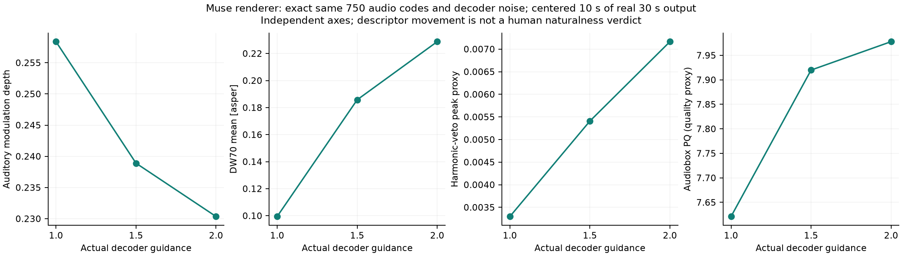
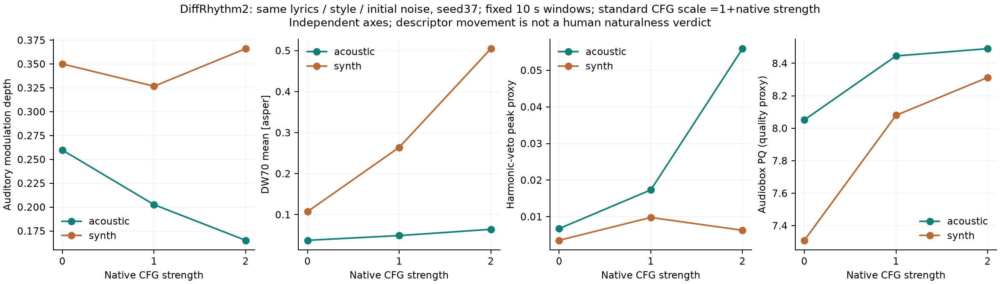

# 真实生成：少人工伪影的提示控制与guidance实验

**最有价值的结果是找到了可实测的控制位置，也发现当前三个描述子不能直接当“电音坏分”。** 本实验归档的MuCodec外层guidance参数实际未传下去；完成实例级路由后，同一音频token与噪声下的真实guidance可以改变声音与指标。提高guidance时roughness与生产质量代理又同时增加，不能只奖励低roughness。人类听感标签仍为0，未训练reward head或RL。

[先听精选真实Suno](https://zhanh-he.github.io/RL-paper-reading/demos/?nat-pair=suno-listen-1#naturalness) · [新生成Prompt/CFG对照](https://zhanh-he.github.io/RL-paper-reading/demos/?nat-corpus=controls#naturalness) · [本轮计划与自我审查](PROMPT_CONTROL_PLAN.md) · [完整清单](runs/2026-11-05-controls/audit.json) · [逐片分数](runs/2026-11-05-controls/sample-scores.csv)

## 做了什么

全部使用现有5090环境与冻结预训练权重；没有排队使用其他集群、停止现有任务、更新模型或调用付费Suno生成API。Suno是已取得的真实V5参考音频；本轮新生成来自DiffRhythm2、SongBloom和Muse/MuCodec。

- **DiffRhythm2文字对照20首60秒**：同一套新写英文歌词，原声indie-pop与明确保留合成器的synth-pop两种风格，seed37/91。每风格/种子比较baseline、追加“不要那么电音味”、英文笼统否定、具体自然发声/瞬态描述且保留原配器，共16首；另在seed37做nativeCFG0/1，复用baseline的nativeCFG2，共4首。
- **共享真实Suno参考8首**：DiffRhythm2与SongBloom各4首，原声/合成器参考各一、各2种子；使用相同新歌词和相同10秒参考原件SHA。SongBloom实际接口是音频参考＋歌词，没有伪造文字negative-prompt能力。相同整数种子跨模型不代表同潜噪声；Suno参考歌词不同，不是自然度gold。
- **Muse/MuCodec4个分析输出，每个30秒**：Muse同全局合成器配器与新歌词，分别使用原描述/具体发声描述，HF采样到750个真实音频token。冻结baseline的同一组750token与相同decoder随机张量，比较实际下层guidance1/1.5/2；另比较具体描述token的guidance1.5。另有2个原生API参数核查输出，只保留工程证明，不重复计作试听效果样本。

共32个纳入分析的原始生成输出，**60个预先规定的10秒窗口**：时长≥50秒取10–20与40–50秒；较短输出取居中10秒，因此Muse均为10–20秒。不是按好听或指标挑窗口。每首也提供完整MP3以检查前后文；窗口均值不冒充全曲音质。原始float WAV留在实验存储；公开MP3为192kbps/48kHz，不作增益或响度归一化，原件/评分片段/试听副本分开绑定SHA。

## 1. 最直接的实现发现：MuCodec外层参数是无效控制

本实验使用的归档[MuCodec代码](https://github.com/tencent-ailab/MuCodec/blob/128f91be6c1457fd4b8822042ec5994d6d58a70b/generate.py#L111)接收guidance_scale，但两处chunk调用都[固定传1.5](https://github.com/tencent-ailab/MuCodec/blob/128f91be6c1457fd4b8822042ec5994d6d58a70b/generate.py#L170)。下层[实际会使用guidance参数](https://github.com/tencent-ailab/MuCodec/blob/128f91be6c1457fd4b8822042ec5994d6d58a70b/model.py#L130)。这是这个归档版本的发现，不概括所有版本/实现。

实际核查：外层传1和2，记录到的下层调用都为1.5；**解码后float32 PCM逐位相同，最大绝对差0**。两份WAV文件哈希不同，原因是libsndfile的PEAK块含写入时间；不能把容器差异误认成声音差异。原生结果也与显式下层1.5的PCM一致。

有效干预只覆盖当前decoder实例的`inference_codes`参数，不修改共享源码/权重。每次记录请求值、实际下层值、token哈希和所有捕获的decoder随机张量哈希。guidance≤1在这个下层实现中都是条件分支；1/1.5/2才是本轮三个有效条件。

| 固定相同token＋噪声，实际guidance | 调制M | DW70 asper | 保护共振N | Audiobox PQ |
|---|---:|---:|---:|---:|
| 1.0 | .25838 | .09943 | .00330 | 7.621 |
| 1.5 | .23890 | .18578 | .00541 | 7.920 |
| 2.0 | .23035 | .22877 | .00716 | 7.978 |

这些值来自同一30秒原始输出的居中10秒。调制下降，roughness/共振/质量代理上升；**因而实际控制生效，不等于已经减少人工感。** 最值得一起听的是[固定token的1与2](https://zhanh-he.github.io/RL-paper-reading/demos/?nat-corpus=controls&nat-pair=muse-renderer-low-high#naturalness)：音乐内容与token固定，比“换一句prompt再比较两首不同编曲”更容易定位renderer的影响。



Muse具体描述、实际guidance1.5时，M=.43398、DW70=.36215、N=.01758、PQ=8.311；三个心理声学量都高于baseline1.5，PQ却更高。这仍不是自然度判决，尤其不能把“按自然描述生成”当成好标签。

## 2. DiffRhythm2：低roughness与质量代理发生分歧

原生[DiffRhythm2 CFG](https://github.com/xiaomi-research/diffrhythm2/blob/main/diffrhythm2/cfm.py)使用`v_cond+s*(v_cond−v_null)`，所以native s=0已经是条件生成，s=2相当于常见定义的scale3。null同时清空歌词与style，不是“不想要音色”的条件。原生seed形参未被应用；本轮由外部重设Python/NumPy/Torch/CUDA并逐块核对初始噪声，四组风格/种子均一致。

| seed37固定歌词、style与初始噪声 | native0 | native1 | native2 |
|---|---:|---:|---:|
| 原声 DW70 | .03759 | .04913 | .06432 |
| 原声 PQ | 8.0515 | 8.4454 | 8.4901 |
| 合成器 DW70 | .10766 | .26424 | .50470 |
| 合成器 PQ | 7.3096 | 8.0795 | 8.3127 |

这两个风格中，CFG越高DW70越高，PQ也越高。单用`−roughness`会选低CFG，却与生产质量代理冲突。PQ不是人工伪影gold，因此也不能据PQ宣布高CFG更自然。此处只有一个seed的guidance扫描，没有总体推断。



**具体描述也不保证指标同向。** 合成器条件下，两种子的具体发声描述相对baseline，DW70分别下降.0463/.0109，但保护共振上升.00914/.00807，PQ下降.2430/.0325；原声条件的DW70反而两种子均上升。原声条件的具体描述尾句也提及“仅在要求时保留合成器”等词；编码器未必理解该条件句，可能引入配器概念，这是本轮混淆，复验应使用分风格文本。需要听是否保留合成器、是否只是音色/鼓点/配器改变，以及是否真减少了目标伪影。[对应合成器试听](https://zhanh-he.github.io/RL-paper-reading/demos/?nat-corpus=controls&nat-pair=prompt-synth-s37-concrete#naturalness)

MuQ-MuLan文本条件诊断：合成器baseline与中文否定/英文否定/具体描述的余弦相似度为.99285/.98941/.98186；原声为.98346/.94533/.86715。余弦接近不证明“忽略了指令”，长序列条件动力学仍可能产生明显变化；它也不证明理解了否定。没有人类标签，不能报告提示遵循率。

## 3. SongBloom和DiffRhythm2：能测哪个更“Suno味”吗

现在能展示真实共享参考输出，**还不能把三个描述子当作Suno味检测器**。为诊断分布差异，另计算M、log(DW70)、log(N)相对原48个真实Suno片段median/IQR的标准化中心距离；越小仅表示靠近这个小集合的三个指标中心。

合成器参考条件下，SongBloom两个种子的距离约.511/.401，DiffRhythm2约.699/.866。SongBloom在这三维空间更近，但不能推出更像Suno、更不自然或更好听。请用[共享合成器参考的跨模型对照](https://zhanh-he.github.io/RL-paper-reading/demos/?nat-corpus=controls&nat-pair=model-synth-audio-ref#naturalness)分别记录Suno音色相似度、人工感、配器保留、音质、音乐性；参考播放器保留原始10秒。

SongBloom部分论文发布变体full-ft曾使用Suno合成数据再微调；[原论文](https://arxiv.org/abs/2506.07634)说明了这一点。本机是社区恢复的full150s base，未独立匹配不可访问的作者原件，不能把上述full-ft信息直接套成本权重的训练证明，更不能天然作为“非Suno”负类。原始归档许可限制学术用途；本页是研究示例，不把社区卡的Apache标记当成原始限制已消失，也不声称无限制输出权利。歌词为本次新写；参考音频来自Muse发布者声明MIT的Suno数据。

## 更值得推进的方案

1. **先做renderer与LM的分层定位。** 本轮已做到固定token/噪声的有效guidance扫描。若听者发现某档更少目标人工感、又保留配器和质量，再在新token/新歌曲上复验；不能用这一条token序列选通用最佳值。
2. **把感知目标与采样手段分开。** [CFG](https://arxiv.org/abs/2207.12598)组合条件/无条件预测，不自带人工伪影识别。“电音压制”是感知目标，CFG只是可用执行器之一。这里直接把roughness或硬阈值窄峰梯度加进扩散采样不是现成可行实现：CPU参考和argmax/阈值不提供端到端可用梯度。
3. **有标签后优先小头＋同预算候选排序，再谈GRPO。** 用真实听评训练缺陷偏好头，并独立保留Suno风格相似度、正常电子音色与配器/质量约束；整首/整族/renderer条件一起留出。候选排序降低了先改训练采样log-prob的工程成本，但仍有reward hacking风险；本轮未启用自动选择，没有训练head，λ_art仍为0。

一个明确可做的后续对比是“同歌词＋好音色条件”与“同歌词＋不想要音色条件”的两分支外推：`v_good+β(v_good−v_bad)`。它不同于当前把歌词/style同时清空的null分支，计算量仍是两次前向；但条件编码器未必表达目标伪影。本轮先验证真实prompt与renderer，没有运行这一新分支，也不声称有效。应等听感定位后再决定是否值得做这项小补丁。

Suno本身有[官方Exclude控件](https://help.suno.com/en/articles/3161921)，不代表已披露其内部CFG机制。以后若测试Suno新生成，应做同提示多次rollout，不能在没有seed接口时称同噪声对照；本轮未调用它。

## 复现与边界

本轮完整运行使用已核验的现有环境，无新训练。公开代码与原始结果放在同一naturalness目录；原件留在实验存储。生成脚本均要求显式指定现有源码/权重路径，不下载或重写共享模型。

```bash
# 从本目录运行；路径使用你有权限的已有模型环境，原件输出在repo外。
export PRIVATE_RUN=/absolute/path/to/private-artifact-control
python prepare_control_inputs.py --registry runs/2026-11-05-controls/inputs.json --output-dir "$PRIVATE_RUN" --reference-manifest "$SUNO_MANIFEST"
# 参考路径绑定从原Suno数据重建的评分WAV；不提供reference-manifest时只生成非参考批次。
CHECKED_BLOOM_LOADER=./load_songbloom_checked.py
DIFF_PY=/absolute/path/to/diff-python
"$DIFF_PY" generate_diff_native.py --source "$DIFF_SOURCE" --assets "$DIFF_ASSETS" --runtime-root "$DIFF_RUNTIME" --batch "$PRIVATE_RUN/diff_batch.json" --output "$PRIVATE_RUN/diff" --seconds 60 --steps 32
"$BLOOM_PY" generate_songbloom_native.py --source "$BLOOM_SOURCE" --assets "$BLOOM_ASSETS" --runtime-root "$BLOOM_RUNTIME" --loader "$CHECKED_BLOOM_LOADER" --batch "$PRIVATE_RUN/bloom_batch.json" --output "$PRIVATE_RUN/bloom" --seconds 60 --steps 36
"$MUSE_PY" muse_prompt_decoder_controls.py lm --model "$MUSE_MODEL" --batch "$PRIVATE_RUN/muse_batch.json" --output "$PRIVATE_RUN/muse-tokens" --audio-tokens 750
"$CODEC_PY" muse_prompt_decoder_controls.py decode --mucodec "$MUCODEC_SOURCE" --tokens "$PRIVATE_RUN/muse-tokens/run.json" --plan "$PRIVATE_RUN/muse_decode_plan.json" --output "$PRIVATE_RUN/muse" --seed 42 --steps 20 --duration 40.96
"$PSY_PY" prepare_generation_excerpts.py --runs "$PRIVATE_RUN/analysis-run.json" --output-dir "$PRIVATE_RUN/excerpts" --manifest "$PRIVATE_RUN/excerpts.json"
"$PSY_PY" auditory_fulltrace.py --manifest "$PRIVATE_RUN/excerpts.json" --output "$PRIVATE_RUN/auditory.json" --device cuda --skip-roughness --threads 4
OPENBLAS_NUM_THREADS=1 OMP_NUM_THREADS=1 "$PSY_PY" score_roughness70.py --manifest "$PRIVATE_RUN/excerpts.json" --output "$PRIVATE_RUN/roughness.json" --workers 4
```

DW使用MoSQITo1.2.1原函数、70dB RMS声压级假设，单独CPU运行；CUDA计算自定义调制与窄峰。Audiobox在60个相同评分WAV上只作生产质量监测，不能补上人工伪影gold；音乐性仍待听评。设备共享运行，因此耗时只作本轮资源记录，不作独占吞吐榜。

保留的执行修复：HF把EOS=None恢复成模型默认，初轮只有218/263个音频token，未混入效果集；显式空EOS列表后才达到750预算。MuCodec按原生40.96秒窗口对不足1024的code做内部重复/分块，最后裁到原750code对应30秒；没有外部新增LM token或人为填充音频，也不称完整歌曲自然结束。首次decoder工作目录不符产生的依赖查找失败修复后重跑，失败不当结果。

所有人工栏初始待评价；精选Suno与本控制集都属于探索。本页支持JSON/CSV导出，评分只在浏览器本机保存。当前没有人类一致性、缺陷准确率或RL改进结论；没有用改变prompt后的指标移动来循环证明reward。
