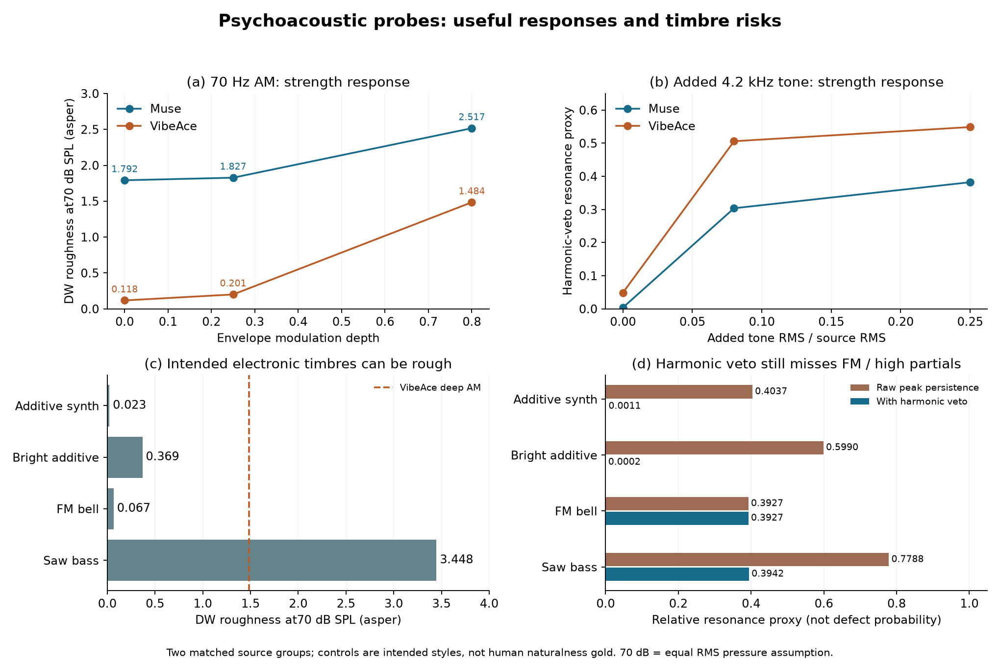

# 辅助：心理声学探针与误伤测试

主实验已转向[真实Suno V5音乐](SUNO_REAL_REPORT.md)。以下47条是辅助机制/误伤测试，不能作为Suno伪影识别有效性的证明。

**子带调制能响应受控buzz；孤立共振加谐波保护后值得继续，但本轮没有任何单项通过“可直接作少人工伪影reward”的验收。** 直接惩罚roughness会损害正常设计的锯齿/明亮音色；谐波保护仍不适用于所有FM音色。下一步优先听共振与音色保护对照，决定哪些特征送入本域偏好模型。

[在线试听与排序](https://zhanh-he.github.io/RL-paper-reading/demos/#naturalness) · [47条分数CSV](runs/2026-11-04-psychoacoustic/sample-scores.csv) · [完整时频与参考模型结果](runs/2026-11-04-psychoacoustic/features.json) · [公开清单](runs/2026-11-04-psychoacoustic/audit.json)

## 跑了什么

2026-11-04，直接使用RTX5090；未使用其他排队集群，也没有停止现有任务。CUDA计算听觉子带与共振描述子，Daniel–Weber参考roughness保持官方CPU实现。47条均为10秒：原25条评分波形完全不变，新增22条；三个scorer与本轮特征的源文件分别保留SHA256，公开MP3也独立绑定。没有训练RL，没有新增人工标签。原25条沿用已测AI分数；新增22条没有补造PQ/SongEval/PAM结果。

新增探针包括两个8变体组（Muse与Vibe Ace）：同源anchor、轻/深70Hz AM、弱/强4.2kHz正弦附加、衰减共振突发、高频提升音色、梳状滤波音色。每组先匹配数字RMS，再用同一个headroom系数缩放，防止增益/削波混淆。高频提升与梳状滤波是有意保留的音色对照，不预判为缺陷。另有1kHz纯音、4/70/200Hz全深AM分析锚点、FM铃声、锯齿低音。

这47条也用于工程调试，不是独立留出测试集。构造处理的强度与类别不是人类人工感标签；“是否复现目标D2的难听感”仍需确认。当前没有可追溯且可公开的目标D2输出，本轮属于代理域实验。

## 主要结果

| 同源操作 | 子带快速调制深度 | DW70 mean asper | 谐波保护共振代理 |
|---|---:|---:|---:|
| Muse：无→轻→深70Hz AM | .359→.411→.522 | 1.792→1.827→2.517 | .0040→.0061→.0042 |
| Vibe Ace：无→轻→深70Hz AM | .252→.270→.322 | .118→.201→1.484 | .0490→.0342→.0174 |
| Muse：无→弱→强4.2kHz音 | .359→.373→.313 | 1.792→1.683→1.557 | .0040→.3037→.3823 |
| Vibe Ace：无→弱→强4.2kHz音 | .252→.244→.184 | .118→.097→.093 | .0490→.5060→.5488 |

**测量方向需要按缺陷分头理解。** 两个AM组的调制与roughness随构造深度递增；窄带音加重时共振代理上升，roughness却下降。后者不代表音质改善，只说明roughness并未覆盖这类操作。所有数字均是处理响应，不能报为检测准确率。

| 意图为正常电子音色的控制 | DW70 mean asper | 原始窄峰代理→谐波保护 |
|---|---:|---:|
| 普通加法合成器 | .023 | .4037→.0011 |
| 明亮加法合成器 | .369 | .5990→.0002 |
| FM铃声 | .067 | .3927→.3927 |
| 带限锯齿低音 | 3.448 | 0.7788→0.3942 |

粗糙感是这些音色的一部分。锯齿控制的roughness高于两组深AM音乐探针；普通→明亮也增加约16倍，因此`−roughness`会偏向更软、更简单的合成器。谐波保护在普通/明亮音色上抑制窄峰分数，但FM铃声与带限锯齿仍高；FM值甚至高于Muse强4.2kHz探针的.3823。不能用一个全局阈值宣布“电音伪影已检出”。

还有两个取巧风险。Muse加亮EQ使调制深度.359→.441，接近甚至超过轻AM的.411，说明快速变化也可能来自合法瞬态与配器。Vibe Ace硬削波使保护共振.0490→.0009；损坏其他质量可以逃过单一共振项。三类特征应是候选特征组，不是相互替代的总质量分。



## 三类实现的确切含义

**听觉子带调制。** 用[SciPy gammatone设计](https://docs.scipy.org/doc/scipy/reference/generated/scipy.signal.gammatone.html)的32个ERB间隔四阶FIR，中心150Hz–16kHz，长度4096；PyTorch CUDA FFT卷积。取解析包络，400Hz低通后降至1kHz，裁去两端各100ms，500ms Hann窗/250ms hop。20–300Hz包络功率经窗能量校正后取方根，再除局部平均包络，按有效子带包络能量加权。排除低于全图最高平均包络−60dB的点。另报峰值调制率±4Hz内功率占比及其平方根加权深度，用来探索稳定buzz与宽带瞬态的区别。

这些是**听觉启发的自定义描述子**，没有Sottek响度压缩、完整频谱/时间掩蔽，也不是asper或ECMA roughness。图中展示能量加权贡献，避免微弱子带的相对调制深度支配颜色；频带延迟未逐带校正，不能据此评瞬态保真。

**参考roughness。** 使用[MoSQITo 1.2.1的`roughness_dw`](https://mosqito.readthedocs.io/en/latest/source/reference/mosqito.sq_metrics.roughness.roughness_dw.roughness_dw.html)，保持Daniel–Weber算法不改；200ms窗、50%重叠，47个Bark通道，输出asper、时间曲线和70dB下的specific roughness。这里没有运行或声称ECMA-418 roughness数值。[ECMA标准](https://ecma-international.org/publications-and-standards/standards/ecma-418/)用于理解快速子带调制与roughness的联系，不能把不同实现混称一致。

WAV不是Pa。我们分别把每条非静音音频映射到60/70/80dB的RMS声压级；这不是等sone，也不是用户真实播放声压。另保留固定换算`1FS=2.828Pa`，即满幅正弦RMS对应100dB SPL。整条静音拒绝，不把0 roughness解释为自然音乐。70Hz全深AM/1kHz/60dB的分析锚点得到1.019asper，接近其约1asper定义。60/80相对70dB的跨样本排序Spearman约.995/.997，**仅为电平稳定性，不是人类一致性**。降低20dB后，70dB归一roughness差约`5.4e−7/1.0e−6`；原电平假设会受音量影响，部署仍需防静音/低音量取巧。

**孤立共振。** 4096点STFT/10ms hop；局部峰超过31频点中值谱背景12dB，并超过当前帧总谱功率的`1e−5`。在250Hz–16kHz取固定频率持久性与突出程度的组合，另报3–8kHz结果。该分数是相对谱结构，不是经过听觉掩蔽验证的可听概率。把“最突出”的候选称为“缺陷”仍需人工判断。

谐波保护是新增工程假设：在原始分数最高的12个频率上，用插值谱峰寻找80–1500Hz强峰能否以2–30倍关系解释；容差为20Hz与候选频率0.3%中的较大者。低于1500Hz且支持至少两个高次谱峰的候选也暂不扣。30阶上限会漏掉正常高次谐波，本轮带限锯齿是这种范围限制的失败例。它不要求给混音估单一F0，但会有偶然谐波匹配、漏检、非谐波乐器误报等问题；参数没有用独立人类集校准。纯音与FM仍高是直接失败例。不要把本实现描述为标准tonality或来源检测。

Musical-noise研究同样提醒原始谱统计不够：[Torcoli的改进指标](https://arxiv.org/abs/2105.13079)有感知预处理并比较处理前后，不能照搬单条峭度；[AES birdies听音材料](https://www.audiolabs-erlangen.de/content/resources/aesCodingTutorial/birdies.html)适合帮助判断构造探针是否接近目标缺陷。

## 速度与部署判断

最终CUDA听觉/共振实现单条10秒中位约**0.009s**，47条总处理**3.29s**，PyTorch峰值已分配约**0.61GB**。单条时间含GPU同步，排除文件解码；总处理含解码与序列化，不含Python导入/初始化。不是GPU总显存占用。CPU/GPU五条代表样本的标量一致性另存回执（最大误差约1.2e−7），算法与参考锚点也有边界测试。

参考DW在同机CPU用4个worker、每个BLAS1线程；46条有效音频×四种电平共184次完整计算，单条四种电平合计中位**46.6s**，初轮wall **523.4s**，带限锯齿修正另复算 **19.7s**；旧锯齿结果未进入最终集。主进程峰值RSS约1.71GB，单个worker最高约1.66GB，未测总进程组峰值。该成本不适合未经工程优化直接逐rollout调用，可先离线作为解释/校准参考；GPU自定义特征速度更适合未来小head，但有效性尚待验证。未使用其他排队集群。

本轮建议：优先保留“调制深度/调制率集中度＋谐波保护共振＋原始谱特征”供小模型与人类对照；roughness保留解释性参考。暂不直接优化任一单项，也不声称加权相加已经解决问题。需要先确认哪种探针像目标伪影，尤其比较FM铃声与真实金属伪影，避免将非谐波电子音色都扣掉。还需真正的目标D2片段和独立听者留出验证。

## 复现

CPU参考段与最终CUDA段分次运行，逐条评分文件SHA一致；参考roughness函数源码经AST提取后逐字相同，见device-agreement回执。源码和结果在既有naturalness目录，权重和原始WAV未上传。CUDA用现有PyTorch2.9.1+cu128环境，另建隔离环境安装MoSQITo与绘图依赖，没有修改共享环境。首次缺少soundfile/matplotlib，通过复用现有依赖路径并在隔离环境安装matplotlib解决；没有把依赖失败当实验结果。相关版本见[requirements-psycho.txt](requirements-psycho.txt)与[运行profile](runs/2026-11-04-psychoacoustic/audit.json)。新建环境的完整安装未另作验证。

```bash
# 从本目录运行；PRIVATE_RUN在repo之外，PSY_PY为可用的CUDA环境。
export PRIVATE_RUN=/absolute/path/to/private-psycho-run
export PSY_PY=/absolute/path/to/cuda-environment/bin/python
# 原件模式：保留已有清单与评分WAV。重建探针时生成新hash，不能冒充旧文件。
"$PSY_PY" prepare_psychoacoustic.py --manifest "$PRIVATE_RUN/original25.json" --directory "$PRIVATE_RUN/probes" --output "$PRIVATE_RUN/manifest47.json"
OPENBLAS_NUM_THREADS=1 OMP_NUM_THREADS=1 MKL_NUM_THREADS=1 "$PSY_PY" psychoacoustic_features.py --manifest "$PRIVATE_RUN/manifest47.json" --output "$PRIVATE_RUN/features.json" --device cuda --workers 4
"$PSY_PY" -m unittest discover -s . -p test_psychoacoustic.py
```

新checkout可从公开MP3重测全部47条，但压缩改变波形，不能逐数复现原件结果：

```bash
"$PSY_PY" playback_manifest.py --audit runs/2026-11-04-psychoacoustic/audit.json --directory "$PRIVATE_RUN/playback"
OPENBLAS_NUM_THREADS=1 OMP_NUM_THREADS=1 "$PSY_PY" psychoacoustic_features.py --manifest "$PRIVATE_RUN/playback/playback-manifest.json" --output "$PRIVATE_RUN/playback-results.json" --device cuda --workers 4
python evaluate_labels.py --audit runs/2026-11-04-psychoacoustic/audit.json --labels listener.json --output agreement.json
```

当前[人工一致性结果](runs/2026-11-04-psychoacoustic/human-agreement.json)是0条标签和空指标。页面支持原25条评分迁移、47条新评分、15组对照、特征排序及JSON/CSV导出；不会自动上传人类评分。用户试听后才能判断实际伪影强弱，不能用探针强度冒充MOS。
