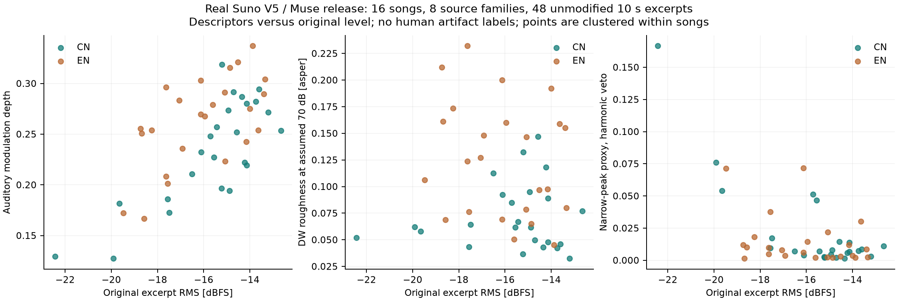
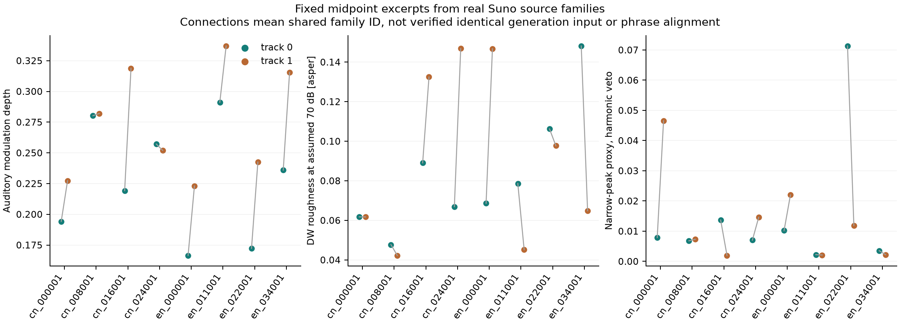

# 真实Suno V5音乐：心理声学特征审计

**目前三类特征都没有通过“可直接用于GRPO压制人工伪影”的听感验收。** 已在16首真实SunoV5歌曲、48条未加工片段上跑通，最有价值的是局部定位与为后续本域偏好头提供输入。固定窄峰代理的残余候选全部在低中频；roughness也不能当成电音坏分。人工标签为0，没有训练reward head或进行新RL训练。

[试听、时间曲线与待评价栏](https://zhanh-he.github.io/RL-paper-reading/demos/#naturalness) · [逐片分数CSV](runs/2026-11-04-suno-real/sample-scores.csv) · [清单](runs/2026-11-04-suno-real/audit.json) · [完整特征与耗时](runs/2026-11-04-suno-real/features.json) · [计划与自我审查](SUNO_REAL_PLAN.md)

## 真实样本与证据范围

来源是[Muse作者公开训练音频](https://huggingface.co/datasets/bolshyC/Muse/blob/b1bf3bf906daab3a896e14f6dea58cc295848452/README.md)，固定revision `b1bf3bf906daab3a896e14f6dea58cc295848452`。数据卡与[论文](https://arxiv.org/abs/2601.03973)报告SunoV5来源和MIT许可。Suno版本依赖发布者来源说明，不是本研究通过声音识别出来的版本。原来的4条本机examples只有文件名线索，因此没有混入本轮。

固定取CN tar分片1/9/17/25、EN1/12/23/35前两个MP3成员，得到8个同族song_id、16个完整track。每曲在可用10秒起点区间20/50/80%截取：`start=(duration−10)×fraction`。选取先于评分，不按指标或主观“好坏”挑片。没有AM、加音、滤波、音量归一化或其他模拟变换。此分片首部样本不是代表Suno总体的随机样本。

源是有损MP3，解码为48kHz双声道float WAV评分（各指标用单声道平均折叠）；不能称恢复了无损母带。公共试听独立转码为192kbps/48kHz MP3，不作响度归一化。全长源、评分片段和试听副本分别有SHA256及tar成员偏移。代码通过HTTP Range取成员，不下载整包音频；元数据流式扫描，只保留所需行。

发布style覆盖中英文流行、抒情、民谣、摇滚以及电子/合成器，但整体仍偏流行/抒情。`cn008001`的两个track是本轮电子风格重点试听组；style是发布者的输出描述，不证明其包含何种可接受或不可接受音色，也不充当“正常合成器”gold标签。

**不能称严格同输入对照。** 16个文件均与发布metadata的audio_path逐一匹配；8组中仅2组归一化发布歌词一致，1组发布style一致。发布的转写/描述不是原始API请求，无法证明生成输入完全一致。因此页面只称同族输出，相对进度也不等于同一句乐句。8个同族ID用于后续保守分组：整首歌、三个片段及另一个track必须同组。

## 实测结果

| 指标 | 最小 | 中位 | 最大 |
|---|---:|---:|---:|
| 子带20–300Hz调制深度 | 0.1273 | 0.2539 | 0.3370 |
| DW70 mean / asper | 0.0324 | 0.0825 | 0.2320 |
| DW70 P95 / asper | 0.0594 | 0.2776 | 1.6974 |
| 固定窄峰代理 / 原始 | 0.1139 | 0.2478 | 0.5002 |
| 固定窄峰代理 / 谐波保护 | 0.0014 | 0.0080 | 0.1666 |

48片段中，调制与DW70的Spearman为0.060；调制与保护共振为-0.622；DW70与保护共振为0.183。这是指标之间的探索性相关，不是人类一致性；48条来自16首歌/8个同族，不能按48个独立样本推断。



### 最值得关注的失败边界

谐波保护共振的候选频率全部在258–1230Hz，没有一个落在3–8kHz。相对原始窄峰，保护后分数逐片降低比例的中位数为96.6%。这不是“去掉了这么多误报”：没有听感标签证明被去掉或留下的是什么。它首先说明固定谱峰结构很容易被正常谐波解释，残余又可能仍是人声/乐器低中频结构。不能声称该代理已经抓住了用户所说的Suno人工感，也不能据此断言歌曲没有高频伪影。

真实Suno的DW70范围仅约0.032–0.232asper，而辅助的深AM探针约1.48–2.52asper；不能把在强模拟探针上响应良好的阈值搬来便声称适用于Suno。

调制深度也没有“越低越自然”的已验证方向。旋律拍频、鼓点/瞬态和合成器都会贡献快速包络变化；目前的rate-concentration描述子只测调制率集中程度，没有测跨子带相位一致性。单一整片均值会混合这些来源。

DW roughness是粗糙感模型，不是Suno缺陷检测器。即使输出为asper，其适用解释也不能自动扩展为音乐人工感。没有人类标签，无法区分它是否标出了问题声部，还是合法失真吉他/电子低音。



### 页面怎样帮助下一轮判断

默认打开真实Suno语料，24组同族试听覆盖8组×3相对位置。匿名模式先隐藏来源和自动分数；可以分别记录人工感、整体音质、音乐性及备注。取消隐藏后，每段附调制、DW70和保护共振曲线，各自独立纵轴；峰值按钮跳到附近，并给出原曲时间。峰值是自动检查位置，不是已经标注的缺陷。可记录例如“0–3秒金属蜂鸣”“人声vocoder感”“鼓点正常”“合成器应该保留”或“无法判断”。

当前没有本研究的人类听感标注，也没有以自动分数冒充实际听过或人工评分。[人工一致性结果](runs/2026-11-04-suno-real/human-agreement.json)为空。两两偏好导出后，可评估同族人类偏好排序，并单独标明内容不一致限制；不能算成严格同输入的因果对照。

旧47条探针在辅助入口，并明确不是本轮Suno有效性证明。它们用于确认实现响应和揭露捷径：正常锯齿/明亮音色可能有较高roughness，FM铃声仍可能被共振误伤，低通、音量变化和硬削波可改变代理分数。详见[辅助报告](PSYCHOACOUSTIC_REPORT.md)。

## 算法、成本与部署

实现和参数沿用[已公开的心理声学定义](PSYCHOACOUSTIC_REPORT.md#三类实现的确切含义)：32个ERB间隔四阶gammatone FIR、150Hz–16kHz、Hilbert包络400Hz低通→1kHz，500ms窗/250ms hop，20–300Hz调制；4096点STFT/10ms hop上的谱峰突出度和持久性，附探索性谐波排除。它们都是自定义描述子，不是标准化roughness或经掩蔽验证的伪影概率。

[MoSQITo1.2.1官方参考roughness_dw](https://mosqito.readthedocs.io/en/latest/source/reference/mosqito.sq_metrics.roughness.roughness_dw.roughness_dw.html)保持Daniel–Weber实现，200ms窗/50%重叠。每片段分别归一到60/70/80dB的RMS声压级，另用固定1FS=2.828Pa（满幅正弦RMS=100dB SPL）计算原电平假设。它不是等sone，也不是耳机播放校准。静音需拒绝，不能把0当自然音乐。

本轮60/80dB相对70dB跨片段排序Spearman为0.992/0.997，仍只是分析电平稳定性。

- **子带调制＋孤立共振**：RTX5090 / CUDA / batch1；10秒片段中位0.0097s；PyTorch峰值分配0.61GB。同步计时；不含解码/初始化。未扰动已有GPU任务。
- **Daniel–Weber参考roughness**：CPU4worker；每worker BLAS1线程；60/70/80dB＋固定FS→Pa；每片段四电平CPU中位69.8s；48条整轮wall845.5s。整轮wall含GPU/解码/序列化/CPU等待，不是CUDA纯耗时。参考roughness先离线用，不直接放rollout热路径。

没有排队使用其他集群，也没有停止已有GPU任务。上述显存为本进程PyTorch峰值分配，不是整机显存。参考roughness较慢，适合作离线解释/校准；在线reward优先探索快速GPU特征加小头，前提是通过真实听评。

## 最值得继续的reward方向

推荐先做**真实人工偏好监督的缺陷头**，把心理声学描述子用来解释和定位；必要时加入冻结音频embedding提供人声/乐器上下文。roughness先当离线辅助，当前固定窄峰分支需重点查误伤。不要先给三项随意加权后拿去GRPO。

可执行的候选形式是：对每个片段特征f做训练集固定的log/robust scaling（median/IQR），使用真实两两偏好训练hθ，让更少不想要人工感的样本得分更高；留出整族歌曲后再校准gθ。候选聚合可用`R_art=1−[0.7×mean(p_bad)+0.3×P90(p_bad)]`，以同时考虑整体和局部问题。这里的权重只是待验证起点，p_bad必须由真实标签校准，不能把现有代理直接当概率。对无效/静音输入先拒绝。

`R_total = R_existing + λ_art·R_art − λ_guard·P_invalid`。目前λ_art=0，仅记录shadow特征；通过真实Suno偏好、正常电子音色保护、音质与音乐性验证后，再以独立数据选择权重。所有窗口使用冻结校准统计，不能逐GRPO组重新定义自然度。低通、降音量、取消鼓点和简化配器必须作为后续对抗审计。

RL/GRPO最终需在可训练模型的新rollout上检验，不仅验证Suno数据。token/连续动作的log-prob必须与实际采样一致，和解码音频奖励的归因单独核查。此轮没有这样的有对照训练，因此不声称已经改善RL。DDSP参考重建loss需要合适的目标/对齐，不能直接定义这里的无参考“不要那么电音”。

## 复现

从本目录执行；PRIVATE_RUN必须在仓库之外。已有可用PyTorch/CUDA环境按[requirements-psycho.txt](requirements-psycho.txt)补依赖。本轮用同一个特征源码，在5090上CUDA计算自定义项、4个CPU worker计算参考roughness；逐条SHA均与公共清单绑定。第一首的3个片段已另行重建验证哈希和metadata一致。

```bash
export PRIVATE_RUN=/absolute/path/to/private-suno-audit
export PSY_PY=/absolute/path/to/cuda-environment/bin/python
python fetch_suno_real.py --output-dir "$PRIVATE_RUN/sources" --with-metadata
"$PSY_PY" prepare_suno_real.py --sources "$PRIVATE_RUN/sources/sources.json" --metadata-dir "$PRIVATE_RUN/sources" --output-dir "$PRIVATE_RUN/clips"
OPENBLAS_NUM_THREADS=1 OMP_NUM_THREADS=1 "$PSY_PY" psychoacoustic_features.py --manifest "$PRIVATE_RUN/suno_manifest.json" --output "$PRIVATE_RUN/features.json" --device cuda --workers 4
"$PSY_PY" signal_features.py --manifest "$PRIVATE_RUN/suno_manifest.json" --output "$PRIVATE_RUN/signal.json"
# 人工听评后导出网页JSON；没有标签时结果为空。
"$PSY_PY" evaluate_labels.py --audit runs/2026-11-04-suno-real/audit.json --labels listener.json --output agreement.json
```

原始数据MP3及固定tar偏移允许直接重取源，不必仅从二次MP3试听副本复测。重建仍应核对当次manifest的哈希；不要将容器或版本差异当作逐数复现。

离线批量入口是`psychoacoustic_features.py --manifest ...`；训练侧可复用其`AuditoryGPU`类先接shadow记录。当前没有已训练的心理声学reward head或可部署权重，不能返回一个假装有效的奖励值：

```python
import torch
from psychoacoustic_features import AuditoryGPU
extract = AuditoryGPU(device="cuda")
# mono48: 解码为48kHz的float单声道音频；有效时长至少1秒。
with torch.inference_mode():
    descriptors = extract(mono48)
# 记录descriptors和音频哈希；人类校准/验证通过后才接已冻结head。
```

已保存的[分组与元数据检查](runs/2026-11-04-suno-real/checks.json)和[计划](SUNO_REAL_PLAN.md)用于下一轮。先一起听电子风格组与指标分歧明显的真实片段，确定真正要压制的听感，再决定哪些特征进入head。
